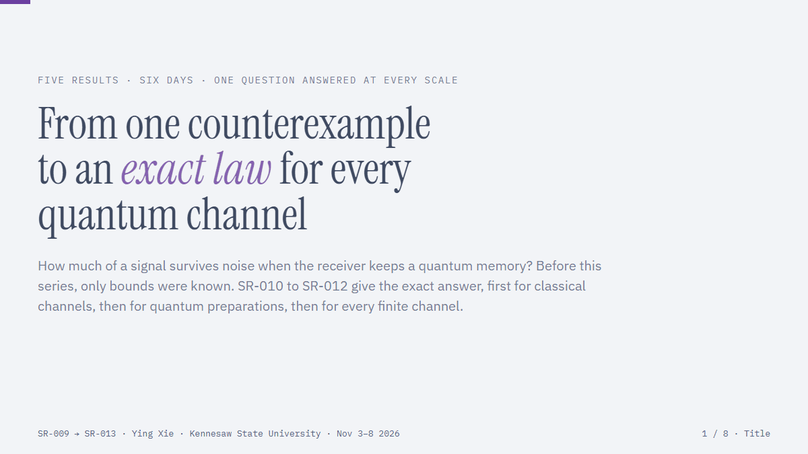

# Quantum Frontier

## Exact Laws and Fundamental Separations in Quantum Information

*An RRE Discovery Series on Purification, Contraction, and Information Retention — SR-009 to SR-013*

| Title | Significance | Zenodo link |
| --- | --- | --- |
| **SR-013.** Exact Information Contraction and Nonvanishing Divergence for Finite Quantum Channels | Equates complete, conditional relative-entropy, and conditional mutual-information contraction for finite quantum channels, using SR-012 and the prior conditional equivalence. Determines the exact ordinary mutual-information coefficient of a depolarizing qubit, giving 1/3 versus 3/8 at half-depolarization. Classifies when near-optimal contraction can retain nonvanishing input divergence, with deficits uniform over growing references, product criteria, and logarithmic copy bounds. The limiting constructions are pointwise; positive divergence alone does not guarantee fixed-error distinguishability or a capacity result. | [Zenodo record](https://zenodo.org/records/24068417) |
| **SR-012.** Exact Complete Relative-Entropy Contraction of Finite Quantum Channels | Determines the exact complete equal-reference Umegaki relative-entropy contraction coefficient of every finite-dimensional quantum channel, extending SR-011 beyond preparation channels. Gives a Choi-matrix optimization, a finite semidefinite program, an exact product law, and the depolarizing coefficient. Constructs witnesses with positive limiting input divergence when the coefficient is one, while a binary obstruction rules out a universal such construction. The results do not establish a capacity or fixed-error operational advantage. | [Zenodo record](https://zenodo.org/records/24047595) |
| **SR-011.** Exact Complete Relative-Entropy Contraction of Finite Classical-to-Quantum Channels | Determines the exact complete equal-reference relative-entropy contraction coefficient of finite preparation channels, including noncommuting and singular quantum outputs. Gives a radius formula and an exact product law, and exhibits faithful binary qubit channels with unbounded amplification over ordinary contraction. Reference dimension two suffices for these binary examples. The matching construction converges pointwise with input divergence tending to zero; it gives no capacity or fixed-error operational guarantee. | [Zenodo record](https://zenodo.org/records/24042111) |
| **SR-010.** Exact Complete Relative-Entropy Contraction of Finite Classical Channels | Determines the exact relative-entropy contraction coefficient of every finite classical channel when the two input states share the same quantum-reference marginal. Reduces the optimization over arbitrary finite reference dimensions to a convex problem over the input simplex, yielding an exact product law and a sharp comparison with ordinary classical contraction. The matching construction converges pointwise with input divergence tending to zero; it gives no capacity or fixed-error operational guarantee. | [Zenodo record](https://zenodo.org/records/23996418) |
| **SR-009.** Classical entanglement of purification is nonadditive with three outcomes per party | Shows nonadditivity already for three outcomes per party using an explicit classical probability table: joint purification of many copies has a strictly lower per-copy cost than one-copy purification. Exact entropy certificates and a direct classical covering argument establish the gap, which persists for strictly positive tables. Binary additivity remains open, and the certified many-copy construction is not a practical small-copy witness. | [Zenodo record](https://zenodo.org/records/23935499) |

The [Math Instruments collection](https://github.com/yxie2/math-instruments#significant-math-results-generated-by-open-ended-autonomous-rre-run) includes the reasoning-route visualizations for SR-010 and SR-009.

## Quantum Memory and Finite-Resource Information Limits

*An RRE Discovery Series on Quantum Storage, Adaptive Control, and Entanglement Survival*

| Title | Significance | Zenodo link |
| --- | --- | --- |
| **QMI-003.** Exact Robustness Frontiers and Fidelity Limits for Qubit Memories | Gives the exact generalized entanglement-breaking robustness frontier under an input resource budget for every qubit noise channel, reduced to a fixed-size semidefinite program with finite classical attainment. Solves the full amplitude-damping curve and proves an adaptive robustness product bound from a perfect memory, sharp for amplitude damping. Determines exact amplitude-damping fidelity and diamond-error limits, showing that classical control can improve fidelity while leaving optimal robustness unchanged. The model uses one persistent qubit and retained classical records; the coefficient-one limit has vanishing input resource. | [Zenodo record](https://zenodo.org/records/24149093) |
| **QMI-002.** Unbounded Additive Gains and Uniform Lifetime Bounds for Controlled Qubit Memories | Shows that changing unitary controls can outperform every repeated fixed unitary: an open set of strictly completely positive qubit channels has m_U = 3 and N_U = N = 4, refuting the stationary-control clause of the Lami–Giovannetti conjecture. A fixed Lindblad generator gives an unbounded additive lifetime gain, while every channel with finite m_U obeys N_U < 50m_U and N < 128m_U. Establishes a common two-sided lifetime scale from Choi concurrence and the minimum output eigenvalue. The separation constructions are perturbative. The deterministic-control comparisons exclude retained ancillas, measurement records and postselection; constants are conservative and N = N_U remains open. | [Zenodo record](https://zenodo.org/records/24212310) |
| **QMI-001.** Exact Finite-Time Limits of Controlled Qubit Memories | Determines exact storage fidelity, diamond-distance error, and branchwise entanglement limits for one persistent qubit under a prescribed sequence of independent unital noise channels, with ideal adaptive control and unlimited classical records. Finite protocols attain every optimum, and even selective controls cannot prolong entanglement survival beyond unitary axis alignment. Also gives separate heralded nonunital and qualitative source-placement results. | [Zenodo record](https://zenodo.org/records/24124639) |

Repository documentation is available under the [MIT License](LICENSE). The linked papers retain the licenses stated in their Zenodo records.
